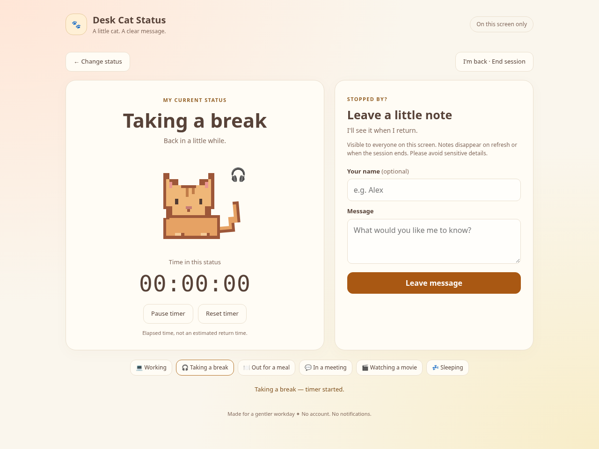

# Desk Cat Status · 桌边小猫

This is a fun tool designed for office workers. When a user temporarily leaves their workstation due to meetings, meals, or breaks, they can choose to display the corresponding status on the workstation computer in advance. This allows colleagues who come to look for them to understand the user's current situation and the time they have left, thereby reducing the frustration of not being able to find the person and not knowing where they have gone. Colleagues can also leave messages directly on the screen, making it convenient for the user to check later when they return.

This small website transforms the display screens on workstations into an intuitive and interesting "status whiteboard". After downloading the project, simply open it with a browser without the need to register an account or connect to the internet.

## Main interaction

The website offers four preset statuses—taking a break, eating, attending a meeting and sleeping—and allows users to enter a custom status. Selecting a status displays the corresponding cat GIF and starts a timer showing how long the user has been in that state. Selecting the current status again keeps the existing timer, while switching to another status starts a new timer. Users can also pause, resume or reset the timer. Visiting colleagues can leave messages for the user to read when they return. Clicking “I'm back” ends the current timer and clears the messages from the session.

## Limits

Currently, the website works on a single device, and statuses and messages cannot be synced across devices. Users can only read messages after returning to their desks. The website does not send notifications or allow users to reply directly. This keeps the tool simple and usable without an account, but makes it better suited to displaying desk status and receiving non-urgent messages than handling time-sensitive communication.

A future improvement could connect the website to workplace messaging or social platforms that users already use. When a colleague leaves a message, the user could receive a notification through their chosen platform and read or reply while away from their desk, without downloading another application. This feature should be optional and clearly explain where messages are sent and how they are stored, preventing information intended for the desk screen from being shared unexpectedly.
## Credits

This project draws on the Week 05 class examples “tiny-image” and “moving-dot,” taking inspiration from their approaches to displaying colour and creating animation on a webpage. During development, I used OpenAI Codex to help write and refine the webpage code, including the timer’s start, pause, resume, reset and end logic, as well as status switching, GIF display and messaging features. The original cat images came from publicly available online resources and were all static images. I edited and animated them in Adobe Photoshop, then exported them as GIFs. The website uses system fonts and does not include external fonts or sound effects.

